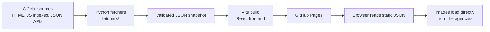

# Weather Observation Dashboard

A static weather dashboard that gathers observation and analysis products from several official agencies into one place, refreshed automatically by GitHub Actions and served from GitHub Pages.

**Live demo:** <https://22cthss-lgtm.github.io/weather-observation-dashboard/>

> **中文簡介**
> 這是一個把多個官方氣象機構的觀測與分析圖資整理在同一處的靜態網站。資料由 Python 程式抓取並整理成 JSON，透過 GitHub Actions 定時更新、驗證後部署到 GitHub Pages；前端以 React 讀取這些靜態 JSON，圖片則直接從官方網址載入，不另存圖檔。
> 目前提供 12 種圖資（臺灣即時觀測、綜觀天氣分析、海洋與颱風潛勢、極區海冰）與雨量排行。另有「熱帶系統專區」（西北太平洋）：整合 CWA、JMA、JTWC 官方路徑的總覽與個別系統頁，NOAA（GFS、AIGFS）與 ECMWF（IFS、AIFS）的確定性數值模式路徑，Ensemble（GEFS、AIGEFS、IFS ENS、AIFS ENS）的成員路徑與 cycle 選擇，以及各系統的「圖像」分頁（JTWC 警報圖）、本站相關環境圖資的連結與各來源署名，第一版（V1）已全部上線。

---

## What it shows

The home page groups the products into four sections. Each card opens a detail page with the latest image, its image time (or the fetch time when the agency gives none) and the source.

| Section | Products | Source |
| --- | --- | --- |
| Taiwan Real-Time Weather Overview | Satellite, Radar, Temperature, Rainfall (with today's time slots, daily rainfall maps and station rainfall rankings) | Central Weather Administration (CWA), CWA Open Data |
| Synoptic Weather Analysis | Surface weather chart, 850 hPa analysis | CWA, Korea Meteorological Administration (KMA) |
| Ocean and Typhoon Potential | Tropical Cyclone Heat Potential (TCHP), Sea Surface Temperature, Wind Analysis (shear / vorticity), Steering Flow (six layers) | CWA, Japan Meteorological Agency (JMA), CIMSS (University of Wisconsin–Madison) |
| Polar and Climate Monitoring | Arctic and Antarctic sea ice (extent, concentration, time series) | National Snow and Ice Data Center (NSIDC) |

Images are always loaded from the agencies' own URLs; the site stores only metadata (URLs, times and hashes), never the image files themselves.

### Tropical Cyclone Center (Western North Pacific)

The first version (V1) is live at [`/tropical`](https://22cthss-lgtm.github.io/weather-observation-dashboard/tropical/): official tracks, deterministic model tracks, ensemble (spaghetti) tracks, an imagery tab per storm and links to the related image pages of this site.

- An overview of active systems, combining the official advisories of CWA, JMA and JTWC. Systems are matched by agency number, name and position.
- A page per storm with each agency's analysis side by side, an interactive map of the official past and forecast tracks (Leaflet with a bundled Natural Earth land outline, no external map tiles), and a timeline aligned to the agencies' real forecast valid times.
- Deterministic model tracks as optional layers on the Forecast tab, all off by default: NOAA GFS and AIGFS (ATCF tracker output) and ECMWF IFS and AIFS (tropical-cyclone BUFR tracks). Shown only for systems matched to an official one. They are labelled as raw model output, not official forecasts and not forecasts made by this site.
- Ensemble member tracks as optional layers on the same tab, also off by default: NOAA GEFS and AIGEFS (ATCF tracker output per member) and ECMWF IFS ENS and AIFS ENS (tropical-cyclone BUFR tracks). Each ensemble is drawn as thin lines, one per member, and a single member can be picked to see its points on the map and the timeline. The page states that the spread of the members is not an official probability; no envelope, mean or probability is computed. Member files are read only when a layer is switched on.
- A cycle selector on the Forecast tab (and `?cycle=YYYYMMDDHH` in the address) switches the deterministic and ensemble layers together to the same initialisation time; up to 4 deterministic and 2 ensemble cycles are kept. The official tracks do not change with it.
- An Imagery tab per storm showing the JTWC warning graphic, loaded by the browser straight from JTWC's website; only addresses on JTWC's product path are shown. The source, the warning issue time, the analysis time of the graphic and this site's fetch time are listed separately, with a note that JTWC reuses one file name for every warning, so the image may be newer than the listed warning. If the graphic cannot be loaded (for example after JTWC removes it when a system ends), a notice and a link to the JTWC website are shown instead. JMA and CWA have no graphic on this site; the tab links to their official typhoon pages. The tab makes no extra data requests.
- Links from the overview and the Imagery tab to this site's existing Satellite, CIMSS Wind Analysis, CIMSS Steering Flow, TCHP and SST pages, labelled as regional or global products rather than storm-specific ones. The overview shows them even when there are no active systems or the data are unavailable.
- An attribution block at the foot of the tropical pages once they have loaded, worded from each agency's terms of use (summarised under "Data sources and attribution" below).
- Display rules: intensities are shown only in the units and averaging periods each agency gives, never converted or compared across agencies. The timeline never interpolates, and forecasts from different initialisation times are labelled as such.

Design notes and the stage-by-stage plan are in [`docs/tropical-cyclone/`](docs/tropical-cyclone/).

---

## How it works



- **Fetchers (Python):** one service per source parses the agency's index or API, picks the newest valid product and checks that the image URL really responds. A failed or invalid fetch keeps the last good data instead of overwriting it.
- **Scheduling:** each product has its own refresh interval and retry backoff ([`fetchers/policies/due-intervals.json`](fetchers/policies/due-intervals.json)). A small relay controller runs about every ten minutes and fetches only the products that are due.
- **Publishing:** each run builds a candidate snapshot in isolation and validates it. A new data version is saved only when the content actually changed. The site is rebuilt and deployed only after its tests and build checks pass.
- **Frontend (React + Vite):** a static single-page app. Each route gets a pre-generated entry page, so direct links work on GitHub Pages. Pages read only the published JSON; reloading a page never triggers a fetch.

More detail: [`docs/data-flow.md`](docs/data-flow.md) (data flow, failure handling and recovery), [`fetchers/README.md`](fetchers/README.md) (fetcher usage) and [`docs/manual-refresh-pages.md`](docs/manual-refresh-pages.md) (manual publishing).

---

## Tech stack

- **Data:** Python 3.13 (tested in CI; the fetchers support 3.10+). Dependencies are `requests` and `python-dotenv`.
- **Frontend:** React 18, React Router 6, Vite 5, and Leaflet for the tropical-cyclone track map.
- **Automation:** GitHub Actions for the relay, publishing, CI, CodeQL and Dependabot; hosting on GitHub Pages.
- **Quality:** Python `unittest`, Vitest with Testing Library, ESLint and Ruff, all run in CI on every push and pull request.

---

## Repository layout

```
fetchers/            Python data fetchers, snapshot/publish tooling and tests
  src/services/      One module per data source
  policies/          Refresh intervals and retry backoff
  tests/             unittest suite (uses saved samples and fakes, no live fetches)
frontend/            React + Vite app
  src/pages/         Dashboard and detail pages
  scripts/           Pages build (pre-generates route entry pages)
  public/data/       Published JSON (written by the fetchers)
docs/                Data flow, refresh and publishing notes, tropical-cyclone design
.github/workflows/   Relay, Pages publishing, CI, CodeQL
```

---

## Running locally

Requirements: Python 3.10+ and Node.js 22 (the version used in CI).

**Frontend**

```bash
cd frontend
npm install
npm run dev
```

Then open the address Vite prints. The app reads the JSON already in `frontend/public/data/`.

**Fetch fresh data** (optional; run from the repository root)

```bash
python -m venv .venv
.venv/Scripts/python -m pip install -r fetchers/requirements-dev.txt
.venv/Scripts/python -B fetchers/update_images.py
```

On macOS or Linux, use `.venv/bin/python` instead. Rainfall rankings use the CWA Open Data API and need a `CWA_API_KEY`. Set it as an environment variable or in a `.env` file at the repository root (ignored by Git), and never commit it. A key can be requested from the CWA Open Data platform. Without a key, the other products still update and the last rankings are kept, but the run reports a failure for the rankings and exits with status 1.

**Tests**

```bash
.venv/Scripts/python -B -m unittest discover -s fetchers/tests
```

`requirements.txt` includes `pybufrkit` and `bitstring<4` (pure Python) for decoding the ECMWF tropical-cyclone BUFR files. `requirements-dev.txt` adds PyYAML, which some workflow tests need, on top of `requirements.txt`.

```bash
cd frontend && npm test -- --run && npm run lint
```

---

## Data sources and attribution

This site redistributes metadata and links to products published by:

- Central Weather Administration (CWA), Taiwan (交通部中央氣象署), including the CWA Open Data platform
- Japan Meteorological Agency (JMA)（出典：気象庁ホームページ）
- Korea Meteorological Administration (KMA)
- Cooperative Institute for Meteorological Satellite Studies (CIMSS), University of Wisconsin–Madison
- National Snow and Ice Data Center (NSIDC)
- Tropical Cyclone Center official tracks:
  - Joint Typhoon Warning Center (JTWC). JTWC data are not subject to copyright protection (17 U.S.C. §403); the warning graphics are loaded from JTWC's website. JTWC products are intended mainly for U.S. government use; for official information please refer to your national meteorological service or the WMO Regional Specialized Meteorological Centre (in Taiwan, the CWA).
  - CWA: 提供機關／交通部中央氣象署 颱風消息與警報-熱帶氣旋路徑（W-C0034-005）, released under the [Open Government Data License](https://data.gov.tw/license)（政府資料開放授權條款）.
  - JMA: 出典：気象庁ホームページ（https://xml.kishou.go.jp/xmlpull.html）. The tables and track maps are processed by this site from JMA's tropical cyclone bulletins（を加工して作成）and are not made by the Japanese government.
  - Land outline: Made with Natural Earth (public domain), clipped and simplified by this site.
- Tropical Cyclone Center model tracks: NOAA / National Weather Service (GFS and AIGFS tracker output, GEFS and AIGEFS ensemble tracker output); not subject to copyright protection (17 U.S.C. §403); this site is not endorsed by NOAA / NWS, and the data are reformatted and filtered, not shown as originally issued. European Centre for Medium-Range Weather Forecasts (ECMWF): "This service is based on data and products of the European Centre for Medium-Range Weather Forecasts (ECMWF)", published under CC BY 4.0; the IFS, AIFS, IFS ENS and AIFS ENS tracks are modified by this site (converted from BUFR to JSON, reduced to the tracks of identified Western North Pacific systems). Disclaimer: "ECMWF does not accept any liability whatsoever for any error or omission in the data, their availability, or for any loss or damage arising from their use." The full wording is shown in the attribution block of the tropical pages.

All images and data remain the property of their respective agencies and are subject to their terms of use. This site is an independent project, not affiliated with or endorsed by any of these agencies. For official forecasts and warnings, please refer to the agencies directly (in Taiwan, the CWA).

The repository does not include a license file yet.
