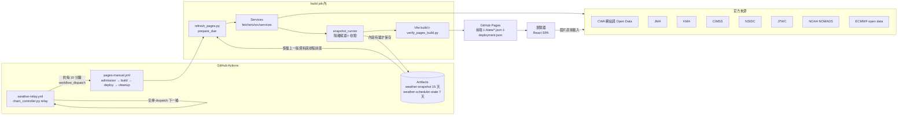

# 系統架構

這份文件只描述系統**現在的樣子**：有哪些元件、資料怎麼流、各部分的程式在哪裡。不記錄歷史、事故或驗收過程。細節請看各節連到的文件。

- 撰寫日期：2026-11-25（Asia/Taipei），程式基準：`origin/main` `9bdfd6e`。
- **維護要求：** 新增或移除 due 任務、資料路徑、workflow 或前端路由時，同步更新本文件與上面的程式基準。

## 1. 一句話總覽

Python Fetcher 讀官方來源的索引或 API，挑出最新且可用的產品，**只產生 JSON metadata**（圖片網址、時間、雜湊）。GitHub Actions 每約 10 分鐘只抓到期的任務，在隔離環境裡建立候選快照並校驗。內容有變才保存新版本，通過測試與建置才部署到 GitHub Pages。React 前端只讀這些靜態 JSON，圖片由瀏覽器直接向各機構載入。

## 2. 元件圖

本機另有一條不經雲端的路徑：`update_images.py`／`watch_images.py` 預設直接寫入 `frontend/public/data/`，只供本機開發與檢視，不會部署。那裡的 repo 版本是測試資料，所以本機執行時建議以 `--output-root` 指到 `.runtime`。

## 3. 執行路徑

| 路徑 | 入口 | 觸發 | 做什麼 | 細節 |
|---|---|---|---|---|
| 自動接力 | `.github/workflows/weather-relay.yml` → `fetchers/chain_controller.py relay` | cron `3-59/10 * * * *`（中斷時的備援）＋上一輪交棒 | 檢查開關與 busy，閒置時 dispatch 一次發布（auto＋refresh＋15 天），等滿 600 秒後 dispatch 下一輪 relay。本身不抓氣象資料、不寫 git、不改 artifact | [data-flow.md 第 13 節](data-flow.md) |
| 發布 | `.github/workflows/pages-manual.yml` | 只有 `workflow_dispatch`（由 relay 或手動；手動可選 `mode` publish／refresh，預設 publish，以及 `snapshot_source` auto／explicit） | admission（身分與去重）→ build（恢復、refresh、測試、建置、保存、讀回校驗）→ deploy → cleanup | [manual-refresh-pages.md](manual-refresh-pages.md)、[due-refresh.md](due-refresh.md) |
| CI | `.github/workflows/ci.yml` | push（所有分支）、PR、手動 | Lint、Python、前端＋Pages build、相依套件稽核 | — |
| CodeQL | `.github/workflows/codeql.yml` | push 到 `main`、PR、每週一（`17 3 * * 1`）、手動 | actions、js-ts、python 靜態分析 | — |
| 本機更新 | `fetchers/update_images.py`、`watch_images.py` | 手動 | 直接更新本機 `frontend/public/data/`，不使用到期策略 | [fetchers/README.md](../fetchers/README.md) |
| 本機快照 | `fetchers/update_snapshot.py` | 手動 | 寫到 `.runtime/snapshots`，不改 public、不部署 | [data-flow.md 第 3 節](data-flow.md) |

**`main` 就是正式環境。** relay 與發布每一輪都 checkout `main`，所以推到 `main` 的程式約 10 分鐘內就會上線。停止自動更新的方法是在 Actions UI 停用 **Weather automatic relay**。

## 4. 到期任務（16 項）

設定在 [`fetchers/policies/due-intervals.json`](../fetchers/policies/due-intervals.json)，全部是 `interval` 模式。只有發布被啟動時才判斷是否到期，任務不會自己醒來。

| 任務 | 間隔 | 來源 | 公開輸出（網站 `/data/` 之下） |
|---|---|---|---|
| radar | 10 分 | CWA | `images/radar/latest.json`、`history/YYYY-MM-DD.json` |
| satellite | 10 分 | CWA | `images/satellite/latest.json`、`history/…` |
| rainfall | 30 分 | CWA | `images/rainfall/latest.json`、`history/…`、`daily/latest.json` |
| rainfall_rankings | 10 分 | CWA Open Data（需 `CWA_API_KEY`） | `rainfall/rankings/latest.json` |
| temperature | 1 小時 | CWA | `images/temperature/latest.json` |
| weather_chart | 6 小時 | CWA | `images/weather_chart/latest.json` |
| 850hpa | 6 小時 | KMA | `images/850hpa/latest.json` |
| cimss_wind_analysis | 3 小時 | CIMSS | `images/cimss_wind_analysis/latest.json`（群組） |
| cimss_steering_flow | 3 小時 | CIMSS | `images/cimss_steering_flow/latest.json`（群組） |
| sst | 1 天 | JMA | `images/sst/latest.json` |
| tchp | 1 天 | CWA | `images/tchp/latest.json` |
| seaice_arctic | 1 天 | NSIDC | `images/seaice_arctic/latest.json`（群組） |
| seaice_antarctic | 1 天 | NSIDC | `images/seaice_antarctic/latest.json`（群組） |
| tropical_official | 30 分 | CWA Open Data（需 `CWA_API_KEY`）、JMA、JTWC | `tropical/official/index.json`、`storms/{id}/{analysis,forecast}.json` |
| tropical_models | 1 小時 | NOAA、ECMWF | `tropical/models/index.json`、`storms/{id}/{cycle}.json` |
| tropical_ensemble | 1 小時 | NOAA、ECMWF | `tropical/ensemble/index.json`、`storms/{id}/{cycle}/{model}.json` |

- 前 13 項是「既有圖資」，後 3 項是熱帶系統專區。熱帶 3 項的 JSON 只在雲端產生並隨快照發布，repo 的 `frontend/public/data/` 裡沒有。
- 失敗時依各任務的 `retry_delays_seconds` 退避，最後一級持續使用。
- 每項的來源網址、最新判定與特殊處理見 [data-flow.md 第 2 節](data-flow.md)（13 項）與第 14–16 節（熱帶 3 項）。

## 5. 程式地圖

### Python（`fetchers/`）

| 分層 | 檔案 | 職責 |
|---|---|---|
| 入口 | `chain_controller.py` | relay 控制器 |
| | `refresh_pages.py`、`prepare_pages.py`、`manage_snapshots.py`、`verify_pages_build.py` | 發布 workflow 的各步驟 |
| | `update_images.py`、`watch_images.py`、`update_snapshot.py`、`update_sst.py` | 本機入口 |
| 設定 | `src/config.py` | 讀 `.env`／`CWA_API_KEY` |
| 舊路徑 | `src/db.py`、`src/models/` | 舊的 SQLite 雨量觀測存檔，靜態流程沒有使用 |
| 編排 | `src/due_refresh.py`、`src/pages_refresh.py` | 選出到期任務、建立候選、部署決策 |
| | `src/update_runner.py`、`src/local_updater.py` | 本機一批或持續更新 |
| | `src/scheduling.py` | 到期判斷與排程狀態（純函式） |
| | `src/history_reconciliation.py`、`src/current_day.py` | 當日 history 與雨量 daily |
| 來源 | `src/services/*_service.py` | 13 項圖資，大致一個來源一個模組（`cwa_service.py` 涵蓋 6 項，`ocean_service.py` 是 JMA SST） |
| | `src/rainfall_rankings.py` | 雨量排行的整理與發布 |
| | `src/services/tropical_*.py` | 熱帶系統：CWA、JMA、JTWC、NOAA、ECMWF |
| | `src/tropical_official.py`、`tropical_models.py`、`tropical_ensemble.py` | 熱帶 3 個任務 |
| | `src/http_client.py` | 共用的重試與每來源請求預算 |
| 發布與快照 | `src/publication.py` | 圖資驗證與原子寫檔 |
| | `src/snapshot_runner.py`、`src/snapshots.py` | 隔離候選、快照白名單與 manifest |
| | `src/tropical_contract.py` | 熱帶 JSON 的公開契約驗證 |
| | `src/content_versions.py` | 內容版本（排除執行時間欄位） |
| | `src/artifact_store.py`、`src/cloud_snapshots.py`、`src/pages_package.py` | artifact 傳輸、恢復、分層保留與安全清理 |
| 測試 | `tests/` | unittest，使用保存的樣本與假物件，不連外 |

### 前端（`frontend/`）

| 檔案 | 職責 |
|---|---|
| `src/App.jsx` | 路由：`/`、`/images/:type`（另有雷達、衛星、雨量、CIMSS、海冰專用頁）、`/tropical`（lazy 載入） |
| `src/api.js`、`src/useCurrentImage.js` | 讀靜態 JSON（`cache: no-cache`），合併當日 history 與 latest |
| `src/pages/*.jsx` | 首頁與各圖資頁 |
| `src/pages/TropicalPage.jsx`、`src/pages/tropical/`、`src/tropical/` | 熱帶系統專區（總覽、個別系統、地圖、預報、圖像分頁） |
| `scripts/pages-build.mjs` | 為每條路由預先產生入口頁，讓 GitHub Pages 的直接連結可用 |

頁面不會觸發 Fetcher，重新整理只會重讀已發布的 JSON。唯一的定時動作是當日圖資頁每 30 秒檢查台北日期，換日時重讀 latest／history。

## 6. 資料與保存

| 資料 | 位置 | 保存 |
|---|---|---|
| 公開 JSON | 網站 `/data/...` | 由快照決定，不 commit 回 repo |
| repo 內的 `frontend/public/data/` | 10/27 的固定版本 | Python 與前端測試的測試資料，也供本機預覽；發布 job 會先換成快照資料，所以不會被部署 |
| 資料快照 | artifact `weather-snapshot`（ZIP＋manifest＋逐檔 SHA） | 15 天；分層保留：最新 6 版、48 小時內每 6 小時一版、14 天內每天一版，加上目前線上版 |
| 排程狀態 | artifact `weather-scheduler-state` | 7 天，留最近兩份 |
| 網站建置 artifact | Pages artifact | 1 天，只供 deploy job 使用，不是資料恢復來源 |
| 部署標記 | 網站 `/deployment.json` | 記錄內容版本與 code／run 身分，用於補部署判斷與安全清理 |
| 本機狀態 | `.runtime/`（不進版控） | 鎖、本機快照、驗證證據 |

完整表格見 [data-flow.md 第 4 節](data-flow.md)，保留策略見 [docs/superpowers/plans/2026-11-10-retention.md](superpowers/plans/2026-11-10-retention.md)。

## 7. 設計原則

1. **只存 metadata，不存圖片本體。** 圖片網址不等於永久保存，官方移除後就看不到。
2. **失敗保留舊資料。** 單一來源或子資源失敗時，保留上一份有效 JSON，不用半套結果覆蓋。群組任一子圖不合格就整組不換。
3. **抓取成功、內容改變、部署成功是三件事。** 內容沒變就不建立新版本；已保存但尚未上線的版本可以補部署。
4. **任務互相隔離。** 熱帶任務各自有 `http_scope()` 與請求預算。熱帶任務失敗不影響 13 項的保存與部署決策。
5. **不盲目重試或重送。** 每次派發最多 POST 一次，結果不明時只查證不重送。發布前的狀態讀取暫時失敗時，本輪不派發但照常交棒（Actions 會出現 `Relay update skipped` 警告）；開關讀取失敗、完整性錯誤與交棒前的查詢失敗才安全停止，由 cron 接回。
6. **密鑰只在產生端使用。** `CWA_API_KEY`（雨量排行與熱帶官方路徑的 CWA 來源使用）只放在 repository secret 或本機 `.env`，只在 refresh 模式傳給發布流程，不寫進 JSON、artifact 或 log。
7. **部署前一定跑測試。** Python 測試、前端測試、build 與 `verify_pages_build.py` 失敗都會阻止部署。

分層失敗處理的完整表格見 [data-flow.md 第 5 節](data-flow.md)。

## 8. 文件地圖

| 想知道 | 看這裡 |
|---|---|
| 對外介紹、本機執行方式 | [README.md](../README.md) |
| 各來源細節、失敗處理、接力控制器的完整規則 | [docs/data-flow.md](data-flow.md) |
| Fetcher 用法與資料契約 | [fetchers/README.md](../fetchers/README.md) |
| 到期策略 | [docs/due-refresh.md](due-refresh.md) |
| 手動發布 | [docs/manual-refresh-pages.md](manual-refresh-pages.md)、[docs/manual-pages.md](manual-pages.md) |
| Fetcher 保護 | [docs/fetcher-protection.md](fetcher-protection.md) |
| 熱帶系統專區的設計、來源、計畫與上線流程 | [docs/tropical-cyclone/](tropical-cyclone/)（`design.md`、`source-matrix.md`、`plan.md`） |
| 開發與上線規則（本機） | `AGENTS.md` |
| 目前狀態、待辦與待驗證（本機） | `HANDOFF.md` |
